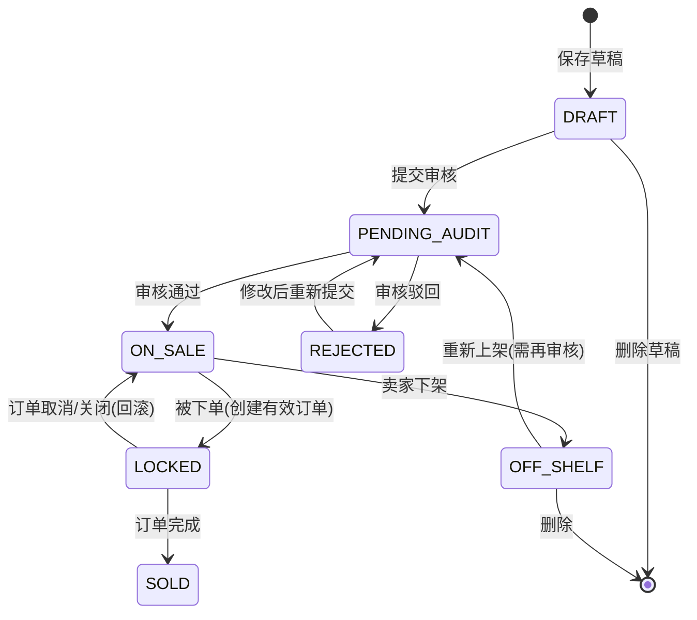
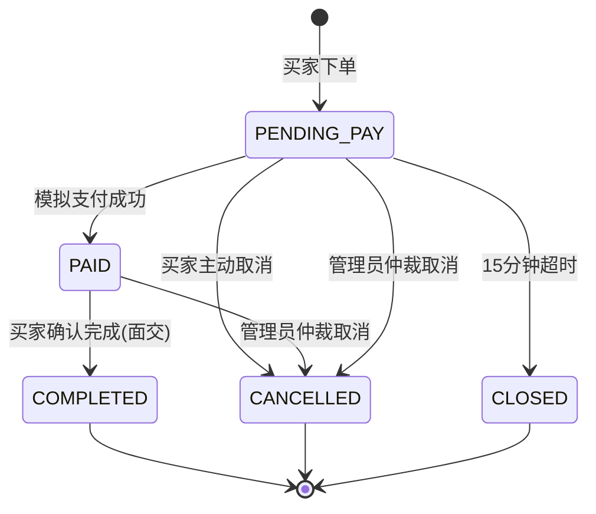

# 1.《需求文档》——校园二手交易平台（拾光集市 · 校园版）

## 目录

- 1.1 文档信息
- 1.2 项目概述
- 1.3 范围与边界
- 1.4 用户角色与权限
- 1.5 核心业务流程
- 1.6 功能需求
- 1.7 业务规则与枚举
- 1.8 非功能需求
- 1.9 页面与交互规格
- 1.10 数据实体概览
- 1.11 验收标准与风险
- 1.12 质量自检

---

## 1.1 文档信息

| 项目 | 内容 |
|---|---|
| 文档名称 | 校园二手交易平台需求文档（PRD） |
| 版本 | V1.0 |
| 作者 | CodeArts Agent（产品/架构/文档角色） |
| 日期 | 2026-11-11 |
| 状态 | 待评审 |
| 读者 | 产品、开发、测试、运维、评审人 |
| 参考 | 华为云"拾光集市"案例（案例中心链接需登录，未能读取原文，结构风格按编号化需求/表格化规则对齐） |

---

## 1.2 项目概述

### 1.2.1 背景

校园内学生闲置物品（教材、数码、生活用品等）处置需求旺盛，现有方式（微信群、贴吧、跳蚤市场）存在信息分散、无法检索、交易无凭证、纠纷无依据等问题。

### 1.2.2 用户痛点

| 痛点 | 现状表现 |
|---|---|
| 信息分散 | 闲置信息散落在群聊中，无法沉淀与检索 |
| 信任缺失 | 买卖双方无平台背书，商品状态描述无约束 |
| 交易无凭证 | 无订单、无支付记录，出现纠纷难以举证 |
| 内容无治理 | 违规商品/广告无人处理，刷屏泛滥 |

### 1.2.3 产品目标

构建校内二手交易平台：学生可发布/浏览/搜索闲置商品，通过"下单—模拟支付—面交确认"完成闭环交易，管理员对商品与举报进行审核治理。

### 1.2.4 成功指标（上线后 1 个月内，[假设] 规模）

| 指标 | 目标值 |
|---|---|
| 注册用户数 | ≥ 500 |
| 发布商品数 | ≥ 300 |
| 成交订单数 | ≥ 100 |
| 商品审核 24h 内完成率 | 100% |
| 核心接口错误率 | < 0.5% |

---

## 1.3 范围与边界

### 1.3.1 本期范围（V1.0）

1. 用户注册/登录/个人资料（校园邮箱注册 [假设]）。
2. 商品发布、编辑、上架/下架、浏览、搜索、分类筛选。
3. 订单：下单、模拟支付、取消、超时关闭、面交确认完成。
4. 商品留言沟通（非实时 IM，[假设]）。
5. 交易互评与信用分展示。
6. 举报（商品/用户）与处理。
7. 管理后台：商品审核、举报处理、用户封禁、订单仲裁、统计看板。

### 1.3.2 非目标（本期不做）

| 非目标 | 说明 |
|---|---|
| 真实支付 | 仅模拟支付，无任何真实资金流、不接入微信/支付宝 |
| 实时聊天 IM | 不做 WebSocket 实时私聊，用商品留言板替代 |
| 邮寄履约 | 不做物流对接；履约方式为校内面交 |
| App/小程序 | 仅 Web（PC + H5 响应式） |
| 分布式/多机 | 不支持水平扩展，单机部署 |
| 竞拍/议价系统 | 不做自动竞价，议价通过留言线下协商 [假设] |
| 积分商城/优惠券 | 不做营销体系 |

### 1.3.3 约束条件

| 编号 | 约束 |
|---|---|
| C-01 | 技术栈固定：Spring Boot 3 + SQLite + Vue 3；后端单实例 |
| C-02 | 数据库为 SQLite 单文件，单写入者，不做分库分表 |
| C-03 | 支付为模拟支付：系统内生成虚拟支付凭证号，无第三方依赖 |
| C-04 | 单机部署，前端构建产物由后端静态资源目录托管（或同一台机器 Nginx，二选一在设计中决策） |
| C-05 | 上线时间与预算未给定，按教学/毕设规模排期 [假设] |

### 1.3.4 依赖

| 依赖 | 说明 |
|---|---|
| D-01 | 校园邮箱后缀规则（如 @stu.xxx.edu.cn）——占位可配置，真实值待确认 |
| D-02 | 敏感词库来源待确认，V1.0 先内置最小词表 [假设] |
| D-03 | 服务器一台（2C4G 即可满足目标规模）[假设] |

---

## 1.4 用户角色与权限

### 1.4.1 角色定义

| 角色 | 说明 | 获得方式 |
|---|---|---|
| GUEST 游客 | 未登录访问者 | 直接访问 |
| USER 注册用户 | 校内学生，兼具买家/卖家双重身份 | 校园邮箱注册 |
| ADMIN 管理员 | 平台治理人员 | 系统预置账号 + 角色授权 [假设] |

### 1.4.2 权限矩阵

| 能力 | GUEST | USER | ADMIN |
|---|---|---|---|
| 浏览商品列表/详情/搜索 | ✅ | ✅ | ✅ |
| 查看商品留言 | ✅ | ✅ | ✅ |
| 注册/登录 | ✅ | — | — |
| 发布/编辑/上下架商品 | ❌ | ✅（仅本人商品） | ✅ |
| 下单/模拟支付/取消/确认完成 | ❌ | ✅（仅本人订单） | ✅（仲裁通道） |
| 发表留言/评价/举报 | ❌ | ✅ | ✅ |
| 查看我的订单/我的商品/我的留言 | ❌ | ✅ | ✅ |
| 商品审核/举报处理/用户封禁/订单仲裁/统计看板 | ❌ | ❌ | ✅ |

> 权限判定原则：USER 只能操作"本人拥有"的资源（本人商品、本人订单参与方）；ADMIN 全量只读可见，写操作仅限治理动作（审核/封禁/仲裁），不得代替用户下单支付。

---

## 1.5 核心业务流程

### 1.5.1 主流程：发布 → 审核 → 交易（文字）

1. 卖家登录后发布商品（标题/描述/分类/成色/价格/图片），商品进入 `PENDING_AUDIT 待审核`。
2. 管理员审核：通过 → `ON_SALE 在售`，可被搜索、可下单；驳回 → `REJECTED`，卖家可修改后重新提交。
3. 买家浏览/搜索到在售商品，可留言咨询，可下单，生成订单 `PENDING_PAY 待支付`，同时商品进入 `LOCKED 交易中`（互斥锁定）。
4. 买家在 15 分钟内完成模拟支付 → 订单 `PAID 交易中`；双方按约定校内面交。
5. 面交完成后买家点击"确认完成"（卖家确认可省略，[假设] 单方确认即完成）→ 订单 `COMPLETED 已完成`，商品 `SOLD 已售出`，双方互评。
6. 若买家不支付：15 分钟超时订单自动 `CLOSED 超时关闭`，商品回滚为 `ON_SALE`；买家也可主动取消。

### 1.5.2 商品状态机

### 1.5.3 订单状态机

### 1.5.4 异常流

| 异常场景 | 系统行为 |
|---|---|
| 并发下单同一商品 | 仅第一个成功；后到者收到"商品已被锁定"业务错误（BR-06） |
| 支付时商品已被管理员下架/封禁 | 支付被拒绝，订单引导取消，商品回滚在售/或保持治理状态 |
| 审核期间商品被下单 | 下单接口校验商品状态必须为 ON_SALE，否则拒绝 |
| 订单完成前商品被举报封禁 | 管理员可仲裁：强制完成或取消；取消则商品回滚 |
| 重复提交支付/取消 | 幂等处理：重复请求返回当前状态，不产生副作用 |
| 用户被封禁 | 其在售商品全部自动下架；进行中订单保留，禁止新建交易行为 |

---

## 1.6 功能需求

> 优先级定义：P0=核心必须，P1=重要，P2=可延期。

### 1.6.1 模块：用户认证与账户（AUTH）

| ID | 名称 | 优先级 | 触发条件 | 系统行为 | 异常处理 | 验收标准（可观察结果） |
|---|---|---|---|---|---|---|
| FR-AUTH-01 | 校园邮箱注册 | P0 | 访客提交注册表单（校园邮箱+昵称+密码） | 校验邮箱后缀（BR-01）→ 创建用户（ACTIVE）→ 返回成功 | 后缀不符/邮箱已注册/密码弱：明确报错，不建号 | 1) 合法校园邮箱注册成功并自动登录；2) 非校园邮箱被拒且提示"仅支持校园邮箱"；3) 重复邮箱报"邮箱已注册" |
| FR-AUTH-02 | 登录/登出 | P0 | 用户提交邮箱+密码 | 校验凭证→签发 JWT→返回用户信息；登出前端清除令牌 | 密码错误提示"邮箱或密码错误"（不提示具体哪项）；被封禁账号拒绝登录 | 1) 正确凭证登录成功；2) 错误凭证返回 401 且连续 5 次失败锁定 10 分钟 [假设]；3) BANNED 用户登录被拒并提示 |
| FR-AUTH-03 | 个人资料管理 | P1 | 用户在个人中心修改昵称/头像/简介 | 更新资料并即时生效 | 昵称长度 2-20 字符校验 | 修改后列表/详情页展示新昵称 |
| FR-AUTH-04 | 修改密码 | P1 | 用户提交旧密码+新密码 | 校验旧密码→更新密码哈希→登出全部会话 | 旧密码错误拒绝 | 改密后旧 JWT 全部失效，需重新登录 |

### 1.6.2 模块：商品（GOODS）

| ID | 名称 | 优先级 | 触发条件 | 系统行为 | 异常处理 | 验收标准（可观察结果） |
|---|---|---|---|---|---|---|
| FR-GOODS-01 | 发布商品 | P0 | 卖家填写标题/描述/分类/成色/价格/图片并提交 | 校验 BR-09/BR-10 → 创建商品 → 状态 PENDING_AUDIT | 校验失败逐字段提示 | 提交成功后"我的商品"中出现待审核记录；游客搜索不到该商品 |
| FR-GOODS-02 | 编辑商品 | P1 | 卖家编辑 PENDING_AUDIT/REJECTED/ON_SALE/OFF_SHELF 状态的商品 | 保存修改；若原状态 ON_SALE/OFF_SHELF 且改动了关键字段（标题/描述/图片/价格），状态回退 PENDING_AUDIT | LOCKED/SOLD 不可编辑，提示原因 | 编辑 ON_SALE 商品改价后商品重新进入待审核、列表暂不可见 |
| FR-GOODS-03 | 上架/下架 | P0 | 卖家对 ON_SALE 商品下架，或对 OFF_SHELF/REJECTED(修改后) 商品上架 | 下架→OFF_SHELF；上架→进入 PENDING_AUDIT（重新审核，BR-05） | LOCKED/SOLD 不可操作 | 下架后游客不可见；重新上架需审核通过才可见 |
| FR-GOODS-04 | 删除商品 | P2 | 卖家删除 DRAFT/OFF_SHELF/REJECTED 商品 | 逻辑删除，列表不再可见 | LOCKED/SOLD/ON_SALE 不可直接删除（ON_SALE 需先下架） | 删除后"我的商品"不显示该条 |
| FR-GOODS-05 | 商品列表浏览 | P0 | 访客/用户打开首页或分类页 | 返回 ON_SALE 商品分页列表（默认按发布时间倒序，20 条/页） | 无数据展示空态 | 首页能看到全部在售商品分页数据；REJECTED/PENDING_AUDIT/SOLD 不出现 |
| FR-GOODS-06 | 商品详情 | P0 | 点击商品卡片 | 返回商品全量信息+卖家昵称+卖家信用分+留言列表 | 已删除/非 ON_SALE 对游客返回 404 或"已下架"提示 | 详情页字段与发布内容一致；被下架商品对游客不可打开 |
| FR-GOODS-07 | 搜索与筛选 | P0 | 输入关键词/选择分类/价格区间/排序 | 关键词匹配标题+描述；分类、价格区间过滤；支持最新/价格升降序 | 无结果空态 | 搜索"考研"能返回标题或描述含"考研"的在售商品；筛选价格 0-50 正确过滤 |
| FR-GOODS-08 | 我的商品 | P1 | 卖家进入"我的商品" | 按状态分组展示本人全部商品及各状态数量 | — | 列表仅含本人商品，状态标签与真实状态一致 |

### 1.6.3 模块：交易与订单（ORDER）

| ID | 名称 | 优先级 | 触发条件 | 系统行为 | 异常处理 | 验收标准（可观察结果） |
|---|---|---|---|---|---|---|
| FR-ORDER-01 | 创建订单（下单） | P0 | 买家在 ON_SALE 商品详情点击"我想要" | 校验 BR-05/BR-06 → 事务内：创建订单 PENDING_PAY + 商品置 LOCKED → 返回订单号 | 商品非在售/已被锁定/买家=卖家：业务错误码提示 | 1) 下单成功生成 15 分钟倒计时；2) 第二个买家下单收到"商品已被锁定"；3) 本人不能购买自己的商品 |
| FR-ORDER-02 | 模拟支付 | P0 | 买家在待支付订单点击"模拟支付" | 校验订单状态与商品治理状态 → 生成虚拟支付凭证号（PAY+时间戳+随机）→ 订单置 PAID，记录支付时间 | 幂等：重复支付返回当前状态；商品已被下架/封禁则拒绝并引导取消 | 1) 支付成功后订单状态变 PAID 且凭证号可见；2) 重复点击不产生第二张凭证；3) 商品被下架后支付被拒 |
| FR-ORDER-03 | 取消订单 | P0 | 买家在 PENDING_PAY 订单点击"取消" | 订单置 CANCELLED，商品回滚 ON_SALE（事务） | 幂等：已取消订单重复取消无副作用 | 取消后商品重新可被他人下单 |
| FR-ORDER-04 | 支付超时自动关闭 | P0 | 订单 PENDING_PAY 超过 15 分钟（BR-03） | 定时任务扫描 → 订单置 CLOSED，商品回滚 ON_SALE | 与买家主动支付/取消并发时：以先发生者为准，后到操作按状态机拒绝 | 构造超时订单后 1 分钟内（扫描周期）状态自动变 CLOSED，商品恢复在售 |
| FR-ORDER-05 | 确认完成 | P0 | 买家在 PAID 订单点击"确认完成（面交完成）" | 订单置 COMPLETED，商品置 SOLD，开放双方评价窗口 | 仅订单参与方可操作；重复确认幂等 | 完成后订单状态 COMPLETED、商品 SOLD，双方可互评 |
| FR-ORDER-06 | 我的订单 | P0 | 用户查看"我买到的/我卖出的" | 分页返回两个维度订单列表（含状态、金额、对方昵称、商品缩略） | — | 买卖双方都能在各自列表看到该订单且状态一致 |

### 1.6.4 模块：留言沟通（MSG）

| ID | 名称 | 优先级 | 触发条件 | 系统行为 | 异常处理 | 验收标准（可观察结果） |
|---|---|---|---|---|---|---|
| FR-MSG-01 | 商品留言 | P1 | 登录用户在商品详情发表留言（≤200 字） | 敏感词过滤（BR-11）→ 落库并实时展示 | 命中敏感词拒绝并提示；纯空白/超长拒绝 | 留言后详情页立即出现，含昵称与时间 |
| FR-MSG-02 | 留言回复与查看 | P1 | 用户查看留言列表 / 点击"回复" | 留言支持一层回复（parent_id），按时间正序展示 | 被删除的父留言显示"该留言已删除" | 回复正确挂载在父留言下 |
| FR-MSG-03 | 未读提醒 | P2 | 收到针对本人商品/本人留言的回复 | "我的留言"入口显示未读数角标 | — | 对方回复后本人角标 +1，查看后清零 |

### 1.6.5 模块：评价（REVIEW）

| ID | 名称 | 优先级 | 触发条件 | 系统行为 | 异常处理 | 验收标准（可观察结果） |
|---|---|---|---|---|---|---|
| FR-REVIEW-01 | 交易互评 | P1 | 订单 COMPLETED 后，买卖双方各自评价（1-5 星+≤200 字） | 校验 BR-07 → 落库；仅订单双方可见入口，评价后双方主页展示 | 非订单参与方/未完成订单/重复评价：拒绝 | 双方各评一次后不可再评；他人无法对非本人订单评价 |
| FR-REVIEW-02 | 信用分展示 | P1 | 访客查看卖家主页/商品详情 | 展示平均星级与评价数（保留 1 位小数） | 无评价显示"暂无评价" | 两次 5 星、一次 3 星的用户显示 4.3 分（(5+5+3)/3） |

### 1.6.6 模块：举报（RPRT）

| ID | 名称 | 优先级 | 触发条件 | 系统行为 | 异常处理 | 验收标准（可观察结果） |
|---|---|---|---|---|---|---|
| FR-RPRT-01 | 举报商品/用户 | P1 | 登录用户对商品或用户发起举报（选择原因+补充说明≤200 字） | 生成举报单 PENDING，进入管理员队列；重复举报同一目标合并提示"已受理" | 未选择原因拒绝提交 | 提交后"我的举报"可见 PENDING 记录 |
| FR-RPRT-02 | 举报结果查看 | P2 | 举报人查看处理结果 | 展示管理员处理结论（属实/不属实）与处理动作摘要 | — | 管理员处理后举报人可见状态变为已处理 |

### 1.6.7 模块：管理后台（ADMIN）

| ID | 名称 | 优先级 | 触发条件 | 系统行为 | 异常处理 | 验收标准（可观察结果） |
|---|---|---|---|---|---|---|
| FR-ADMIN-01 | 商品审核 | P0 | 管理员处理 PENDING_AUDIT 队列 | 通过→ON_SALE；驳回（必填原因）→REJECTED，通知卖家侧可见原因 | 幂等：已审核商品不可重复审核 | 通过后商品出现在首页；驳回后卖家"我的商品"可见驳回原因 |
| FR-ADMIN-02 | 举报处理 | P1 | 管理员处理 PENDING 举报单 | 结论属实：可下架商品/封禁用户（BR-08）；不属实：关闭举报单；记录处理说明 | 已处理单不可重复处理 | 属实举报处理后对应商品下架且举报单状态更新 |
| FR-ADMIN-03 | 用户管理 | P1 | 管理员按昵称/邮箱检索用户并执行封禁/解封 | 封禁（BR-08）：用户置 BANNED，其在售商品全部 OFF_SHELF，禁止登录与交易；解封恢复 ACTIVE | 不能封禁管理员账号 | 被封禁用户登录被拒；其在售商品从首页消失；解封后恢复 |
| FR-ADMIN-04 | 订单仲裁 | P2 | 管理员对异常订单强制完成/取消 | 仲裁取消：退款为模拟口径（凭证作废），商品回滚 ON_SALE；仲裁完成：商品 SOLD | 已终结订单不可仲裁 | 仲裁动作后订单状态、商品状态与仲裁结论一致 |
| FR-ADMIN-05 | 统计看板 | P2 | 管理员打开看板 | 展示：用户总数/今日新增、商品总数/待审核数、订单总数/今日成交额（模拟）、近 7 日订单趋势 | — | 看板数字与库内统计口径一致（误差 0） |

---

## 1.7 业务规则与枚举

### 1.7.1 业务规则（BR）

| 编号 | 规则 | 说明 |
|---|---|---|
| BR-01 | 注册邮箱后缀必须属于校园域 | 后缀白名单可配置（占位 `@stu.example.edu.cn`，真实值待确认 Q1） |
| BR-02 | 商品状态机如 1.5.2 | 状态迁移必须由合法动作触发，非法迁移返回业务错误 |
| BR-03 | 待支付订单保留 15 分钟 | 超时由定时任务（每分钟扫描）关闭并回滚商品 |
| BR-04 | 模拟支付无真实资金流 | 支付成功即生成虚拟凭证号 `PAY+yyyyMMddHHmmss+4位随机`，仅作凭证展示 |
| BR-05 | 只有 ON_SALE 且未被锁定的商品可下单 | 下单接口前置校验，事务内二次校验防并发 |
| BR-06 | 一件商品同一时刻最多 1 个有效订单 | 有效订单=PENDING_PAY/PAID；创建订单用事务+状态条件更新（乐观锁语义）保证互斥 |
| BR-07 | 评价规则 | 仅 COMPLETED 订单双方可评；每订单每人 1 次；交易完成 7 天后未评价视为放弃 [假设] |
| BR-08 | 封禁规则 | 封禁用户：禁登录/禁发布/禁交易，在售商品自动下架；解封后需手动重新上架 |
| BR-09 | 价格范围 | 0.01 ~ 99999.99 元，两位小数 |
| BR-10 | 图片规则 | 每商品 1~9 张，单张 ≤ 5MB，格式 jpg/png/webp |
| BR-11 | 敏感词过滤 | 留言、商品标题/描述、评价内容命中敏感词即拒绝提交；词表内置最小集 [假设] |
| BR-12 | 金额与成交口径 | 订单金额=下单时商品价格快照，商品改价不影响已创建订单 |

### 1.7.2 枚举定义（全文档唯一口径）

| 枚举 | 取值 | 中文 |
|---|---|---|
| GoodsStatus | DRAFT / PENDING_AUDIT / REJECTED / ON_SALE / LOCKED / SOLD / OFF_SHELF | 草稿/待审核/审核不通过/在售/交易中/已售出/已下架 |
| OrderStatus | PENDING_PAY / PAID / COMPLETED / CANCELLED / CLOSED | 待支付/交易中/已完成/已取消/超时关闭 |
| UserStatus | ACTIVE / BANNED | 正常/封禁 |
| Role | USER / ADMIN | 注册用户/管理员 |
| AuditAction | APPROVE / REJECT | 审核通过/驳回 |
| ReportTargetType | GOODS / USER | 商品/用户 |
| ReportStatus | PENDING / RESOLVED / DISMISSED | 待处理/属实已处理/不属实关闭 |
| Condition(成色) | NEW / LIKE_NEW / GOOD / WELL_USED | 全新/几乎全新/轻微使用/明显使用 |
| SortType | LATEST / PRICE_ASC / PRICE_DESC | 最新/价格升序/价格降序 |
| TradeRole | BUYER / SELLER | 买方视角/卖方视角（"我的订单"查询维度） |

### 1.7.3 计算公式

| 公式 | 定义 |
|---|---|
| 卖家信用分 | 该用户作为卖家收到的全部评分算术平均，保留 1 位小数；无记录显示"暂无评价" |
| 今日成交额 | 当日状态变为 COMPLETED 的订单金额之和（模拟口径） |

---

## 1.8 非功能需求（量化）

| ID | 类别 | 指标（量化） | 验证方式 |
|---|---|---|---|
| NFR-PERF-01 | 性能 | 50 并发下，商品列表/搜索接口 P95 ≤ 500ms，错误率 < 1% | JMeter 压测报告 |
| NFR-PERF-02 | 性能 | 商品详情接口 P95 ≤ 300ms（含 SQLite 单机） | JMeter 压测报告 |
| NFR-PERF-03 | 容量 | 支持 2000 注册用户、日活 300、商品 ≤ 1 万条、订单 ≤ 5 万条不降级 | 数据量模拟脚本 |
| NFR-SEC-01 | 安全 | 密码使用 BCrypt（强度 ≥ 10）存储，库内禁止明文 | 代码审查+数据抽查 |
| NFR-SEC-02 | 安全 | 全部写接口与"我的xx"接口需 JWT 鉴权；越权访问他人资源返回 403 | 越权测试用例 |
| NFR-SEC-03 | 安全 | SQL 全部参数化查询，无字符串拼接；XSS 输出转义 | 代码扫描+注入用例 |
| NFR-SEC-04 | 安全 | 管理操作（审核/封禁/仲裁）全部落审计日志（操作人/时间/对象/动作） | 审计日志表抽查 |
| NFR-SEC-05 | 安全 | 登录连续失败 5 次锁定 10 分钟 [假设] | 安全用例 |
| NFR-AVAIL-01 | 可用性 | 工作时段（8:00-22:00）可用性 ≥ 99%；单机重启恢复 ≤ 5 分钟 | 部署演练 |
| NFR-AVAIL-02 | 数据 | SQLite 数据库文件每日 02:00 自动备份，保留 7 份；RPO ≤ 24h，RTO ≤ 1h | 备份恢复演练 |
| NFR-COMPAT-01 | 兼容 | Chrome/Edge/Safari 最新两个大版本功能正常 | 浏览器回归 |
| NFR-COMPAT-02 | 兼容 | H5 响应式：≥ 375px 宽度核心流程可用 | 移动端用例 |
| NFR-MAINT-01 | 可维护 | 核心模块（订单/商品状态机）单元测试行覆盖率 ≥ 60% | 覆盖率报告 |
| NFR-MAINT-02 | 可维护 | 统一日志格式含 traceId；ERROR 日志须可定位到接口与原因 | 日志抽查 |
| NFR-MAINT-03 | 可维护 | 配置项集中在 application.yml + 环境变量，敏感信息不出现在代码库 | 代码审查 |

---

## 1.9 页面与交互规格

### 1.9.1 页面清单

| 路径 | 页面 | 可见角色 | 关键交互 |
|---|---|---|---|
| / | 首页商品列表 | 全部 | 分类导航、关键词搜索框、商品卡片（图/标题/价格/卖家）、分页/下拉加载 |
| /goods/:id | 商品详情 | 全部 | 图片轮播、成色/价格/描述、卖家信用分、留言区、（买家）"我想要"下单、（卖家）编辑/上下架、举报入口 |
| /search | 搜索结果 | 全部 | 关键词+分类+价格区间+排序组合筛选 |
| /login /register | 登录/注册 | 游客 | 表单校验、错误提示 |
| /publish | 发布/编辑商品 | USER | 图片上传（1-9 张）、表单校验、保存草稿/提交审核 |
| /my/goods | 我的商品 | USER | 状态分组 Tab、上下架/编辑/删除操作 |
| /my/orders | 我的订单 | USER | "我买到的/我卖出的"Tab、倒计时、模拟支付按钮、取消/确认完成、评价入口 |
| /my/messages | 我的留言 | USER | 未读角标、留言与回复列表 |
| /my/profile | 个人资料 | USER | 昵称/头像/简介修改、修改密码 |
| /user/:id | 他人主页 | 全部 | 该用户在售商品、信用分与收到的评价 |
| /my/reports | 我的举报 | USER | 举报记录与处理结果 |
| /admin/dashboard | 统计看板 | ADMIN | 指标卡片+近 7 日趋势图 |
| /admin/goods | 商品审核 | ADMIN | 待审核队列、预览、通过/驳回（原因必填） |
| /admin/reports | 举报处理 | ADMIN | 待处理队列、处理（下架商品/封禁用户/关闭） |
| /admin/users | 用户管理 | ADMIN | 检索、封禁/解封 |
| /admin/orders | 订单仲裁 | ADMIN | 订单检索、仲裁完成/取消 |

### 1.9.2 关键空态/异常态

| 场景 | 展示 |
|---|---|
| 列表无数据 | 插画+文案"还没有相关商品，去看看别的吧" |
| 搜索无结果 | "没有找到与'xx'相关的商品"+ 清除筛选按钮 |
| 商品已下架/删除 | 详情页提示"商品已下架或不存在"+ 返回首页按钮 |
| 订单待支付倒计时结束 | 列表自动刷新为"超时关闭"，商品可重新购买 |
| 网络错误 | 统一 toast"网络异常，请稍后重试"，表单数据不丢失 |
| 未登录点击需登录操作 | 跳转登录页，登录成功后回跳原页面 |

---

## 1.10 数据实体概览

| 实体 | 关键字段 | 关系 |
|---|---|---|
| User 用户 | id、email(唯一)、password_hash、nickname、avatar_url、bio、role、status、created_at | 1..N Goods；N..N Order（作为 buyer/seller） |
| Category 分类 | id、name、sort、status | 1..N Goods |
| Goods 商品 | id、seller_id、category_id、title、description、condition、price、images(JSON)、status、reject_reason、published_at、deleted | N..1 User；1..N Order(有效期内) |
| Order 订单 | id、order_no(唯一)、goods_id、buyer_id、seller_id、amount(价格快照)、status、pay_voucher_no、pay_time、complete_time、cancel_reason、timeout_at、created_at | N..1 Goods/User；1..1 Review 对(0..2 条评价) |
| Message 留言 | id、goods_id、sender_id、parent_id、content、is_read、deleted、created_at | N..1 Goods/User |
| Review 评价 | id、order_id、reviewer_id、reviewee_id、role(买家评卖家/卖家评买家)、rating(1-5)、content、created_at | N..1 Order |
| Report 举报 | id、reporter_id、target_type、target_id、reason、detail、status、handler_id、handle_note、handled_at | N..1 User |
| AuditLog 审计日志 | id、operator_id、action、target_type、target_id、detail、created_at | 管理操作流水 |

> 完整字段、索引与建表语句见《设计文档》第 4 章。

---

## 1.11 验收标准与风险

### 1.11.1 整体验收口径

1. 全部 P0 功能需求验收标准逐条通过；P1 至少 90% 通过；P2 可延期但需登记。
2. 全部 BR 抽测通过（尤其 BR-03 超时、BR-06 并发互斥）。
3. NFR-PERF/SEC/AVAIL 量化指标按 1.8 验证方式出具报告。
4. 无 P0/P1 级缺陷遗留；P2 缺陷 ≤ 3 且有规避方案。
5. 追溯矩阵无孤儿需求、无未覆盖设计。

### 1.11.2 主要风险与假设

| 风险/假设 | 影响 | 应对 |
|---|---|---|
| [假设] 校园邮箱后缀未知，用可配置白名单占位 | 注册口径偏差 | 上线前确认 Q1，仅改配置 |
| [假设] 面交单方确认即完成，可能存在"未面交先确认"纠纷 | 交易争议 | V1.0 靠举报+仲裁兜底；V1.1 可引入双方确认 |
| SQLite 单写入者，压测下写并发受限 | 高并发下单可能排队 | 目标规模（日活 300）远低于阈值；压测验证 NFR-PERF-01 |
| 敏感词最小词表覆盖不足 | 违规内容漏网 | 举报通道兜底 + 词表可热更新配置 |
| 模拟支付凭证无法律效力 | 不可用于真实纠纷举证 | 明示"模拟支付"文案，非目标声明 |

---

## 1.12 质量自检（需求文档）

| 检查项 | 结果 |
|---|---|
| 每条 FR 有唯一 ID 且含触发条件/行为/异常/验收标准 | ✅（30 条 FR 全覆盖） |
| NFR 全部量化且给出验证方式 | ✅（15 条） |
| 非目标与约束明确 | ✅（7 项非目标、5 项约束） |
| 状态机/枚举与全文一致 | ✅（与设计/开发/追溯矩阵共用 1.7.2 口径） |
| 假设均标注并登记待确认清单 | ✅（见 05 文档） |