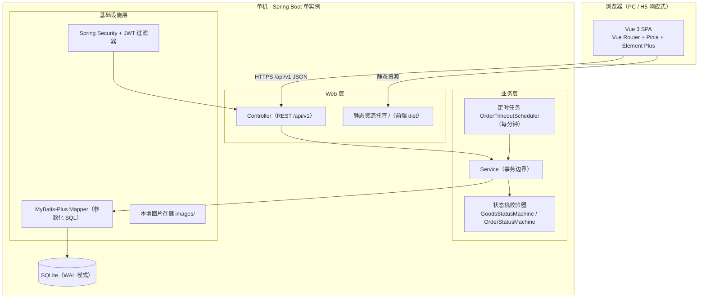
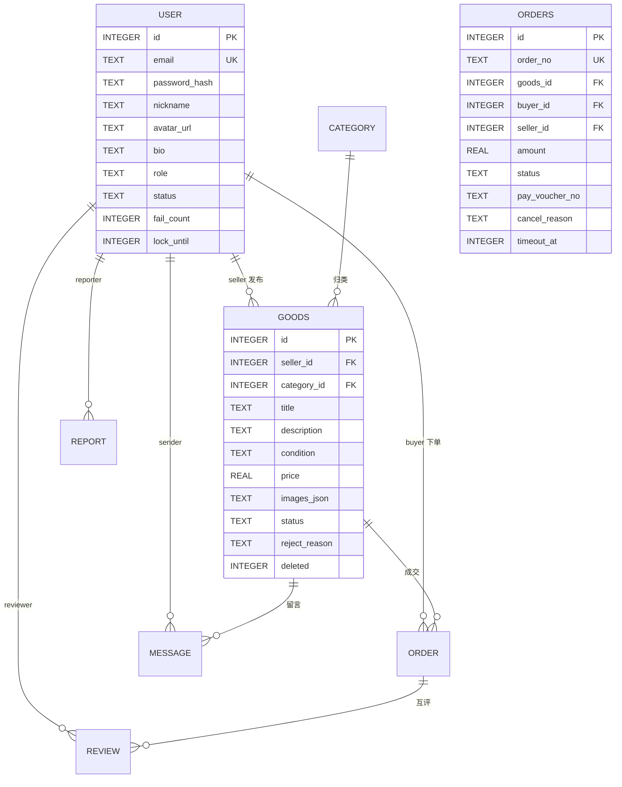
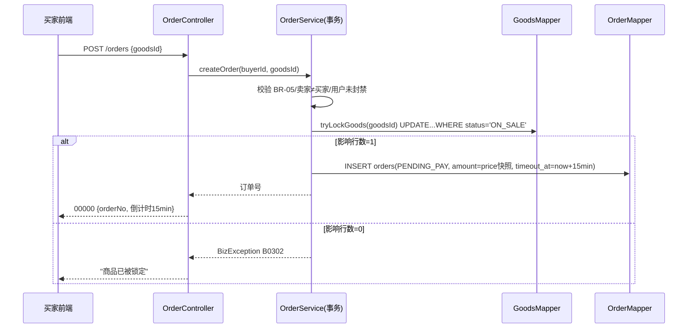
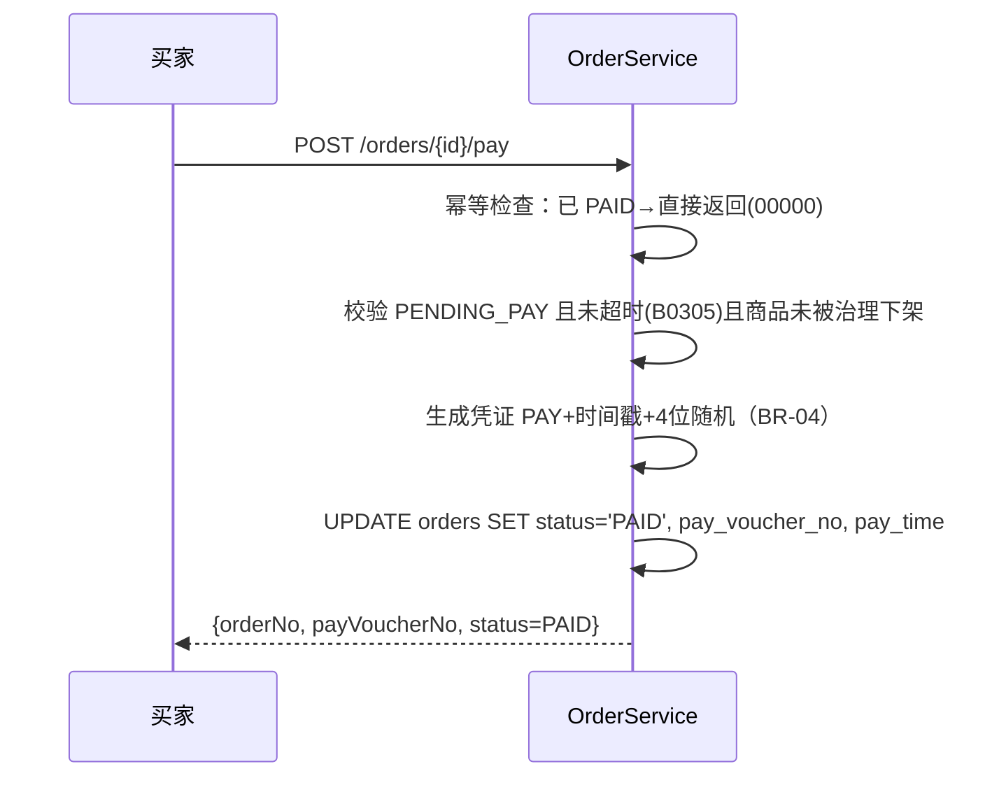
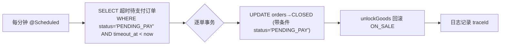
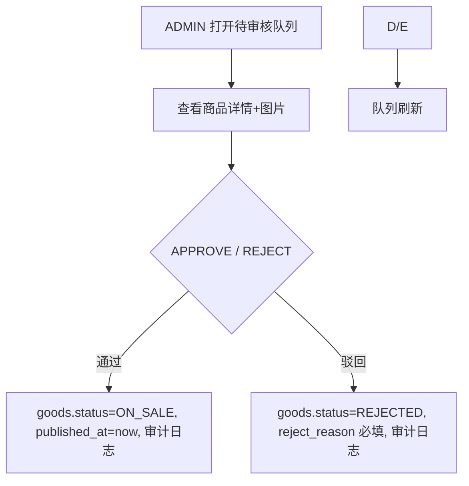

# 2.《设计文档》——校园二手交易平台（拾光集市 · 校园版）

## 目录

- 2.1 文档信息与设计目标
- 2.2 架构设计
- 2.3 模块设计
- 2.4 数据设计
- 2.5 接口设计
- 2.6 关键流程设计
- 2.7 非功能实现
- 2.8 异常与边界
- 2.9 架构决策记录（ADR）
- 2.10 需求追溯（FR/NFR → 设计章节）
- 2.11 质量自检

---

## 2.1 文档信息与设计目标

| 项目 | 内容 |
|---|---|
| 文档名称 | 校园二手交易平台设计文档（HLD + 关键 LLD） |
| 版本 | V1.0 |
| 日期 | 2026-11-11 |
| 状态 | 待评审 |
| 读者 | 开发、测试、运维 |
| 上游文档 | 《需求文档》V1.0 |

**设计目标**：在"单机 + SQLite + 模拟支付"约束下，以最小复杂度实现需求文档全部 P0/P1 功能与量化 NFR；状态机正确性、并发互斥正确性（BR-06）、可测试性是本设计的一等公民。

---

## 2.2 架构设计

### 2.2.1 总体架构图



### 2.2.2 分层职责

| 层 | 职责 | 禁止事项 |
|---|---|---|
| Controller | 参数校验（@Valid）、调用 Service、包装统一响应 Result | 不写业务逻辑、不直接访问 Mapper |
| Service | 业务规则、事务边界、状态机调用、领域校验 | 不操作 HttpServletRequest、不拼 SQL |
| Mapper | 参数化 SQL / MyBatis-Plus CRUD | 不含业务判断 |
| Security | JWT 解析、角色/权限拦截 | 不理解业务状态 |
| Scheduler | 超时订单扫描 | 只调 Service，不直写 DB |

### 2.2.3 部署拓扑

| 项 | 方案 |
|---|---|
| 部署形态 | 单机单进程：`java -jar market.jar`（内置 Tomcat，端口 8080） |
| 前端交付 | Vue `npm run build` 产物复制到后端 `static/`，由 Spring Boot 托管（ADR-007） |
| 数据库 | SQLite 单文件 `data/market.db`，开启 WAL；备份脚本每日 02:00 `sqlite3 .backup` 生成 `data/backup/market-YYYYMMDD.db`，保留 7 份（cron） |
| 图片 | 本地目录 `data/images/`，通过 `/api/v1/files/**` 映射读取 |
| 进程守护 | systemd 单元 `market.service`，崩溃自动重启（NFR-AVAIL-01） |

### 2.2.4 技术选型及理由

| 组件 | 选型 | 版本 | 理由 | 替代方案与取舍 |
|---|---|---|---|---|
| 语言/运行时 | Java | 17 [假设] | Spring Boot 3 最低要求、LTS | Java 21 可用但无必要 |
| 后端框架 | Spring Boot | 3.2.x [假设] | 生态成熟、内嵌容器、单 jar 部署 | 无 |
| 持久层 | MyBatis-Plus | 3.5.x | 手写参数化 SQL 灵活、无复杂 ORM 映射，适配 SQLite 方言简单 | Spring Data JPA：对象映射省事，但 SQLite 方言需额外配置且复杂查询不直观 → 否 |
| 数据库 | SQLite + WAL | 3.40+ | 零运维、单文件、满足容量约束（BR/约束 C-02） | MySQL：需额外运维进程，单机场景收益为负 → 否（ADR-001） |
| 鉴权 | Spring Security + jjwt | 0.12.x | 无状态 JWT，前后端分离标准做法 | Session：单机可行，但前端跨域/移动端扩展性差 → 否（ADR-002） |
| 密码散列 | spring-security-crypto BCrypt(10) | — | 满足 NFR-SEC-01 | — |
| 校验 | hibernate-validator（starter-validation） | — | 声明式校验 | 手写校验：重复劳动 → 否 |
| 定时任务 | Spring @Scheduled | — | 单机足够 | Quartz：过度设计 → 否 |
| 前端框架 | Vue 3 + Vite | Vue 3.4 / Vite 5 [假设] | 用户指定 Vue；Vite 构建快 | React：用户指定 Vue → 否 |
| UI 组件库 | Element Plus | 2.x [假设] | 组件齐全、中文文档 | Naive UI/Ant Design Vue 均可，Element Plus 教学资料最多 |
| 状态管理 | Pinia | 2.x | Vue 3 官方推荐 | Vuex：旧 → 否 |
| HTTP 客户端 | Axios | 1.x | 拦截器统一处理 token/错误 | fetch：拦截逻辑重复造轮子 → 否 |
| 测试 | JUnit 5 + Mockito + Spring Boot Test | — | 标准 | — |
| 构建 | Maven 3.9 / npm | — | 标准 | — |

---

## 2.3 模块设计

### 2.3.1 后端包结构

```
com.campus.market
├── config/          SecurityConfig, JwtProperties, WebConfig(静态映射), AsyncConfig
├── common/          Result, ErrorCode, BizException, GlobalExceptionHandler, PageResult
├── security/        JwtUtil, JwtAuthFilter, SecurityUtils(当前用户)
├── controller/      AuthController, UserController, GoodsController, FileController,
│                    OrderController, MessageController, ReviewController, ReportController,
│                    AdminController
├── service/         AuthService, UserService, GoodsService, OrderService,
│                    MessageService, ReviewService, ReportService, AdminService, FileService
│    └── impl/
├── mapper/          UserMapper, GoodsMapper, OrderMapper, ... (MyBatis-Plus BaseMapper)
├── entity/          User, Category, Goods, Order, Message, Review, Report, AuditLog
├── dto/             request/*, response/*（与 2.5 契约一一对应）
├── statemachine/    GoodsStateMachine, OrderStateMachine（合法迁移表 + 校验）
└── scheduler/       OrderTimeoutScheduler
```

### 2.3.2 模块依赖与职责

| 模块 | 职责 | 依赖 | 承载需求 |
|---|---|---|---|
| security | 注册/登录、JWT 签发与解析、登录失败锁定 | — | FR-AUTH-01/02/04、NFR-SEC-02/05 |
| goods | 商品 CRUD、上下架、搜索筛选、图片上传关联 | security | FR-GOODS-01~08 |
| order | 下单互斥、模拟支付、取消/关闭/完成、我的订单 | goods、statemachine | FR-ORDER-01~06、BR-03/04/05/06/12 |
| statemachine | 两台状态机的合法迁移表与守卫校验 | — | BR-02、订单/商品全状态迁移 |
| scheduler | 超时订单扫描关闭 + 商品回滚 | order | FR-ORDER-04 |
| message | 留言/回复/未读数 | goods、security | FR-MSG-01~03、BR-11 |
| review | 互评与信用分计算 | order | FR-REVIEW-01/02、BR-07 |
| report | 举报受理与结果查询 | — | FR-RPRT-01/02 |
| admin | 审核、举报处理、封禁、仲裁、统计 | goods/order/report/user | FR-ADMIN-01~05、BR-08 |

> 禁环原则：controller → service → mapper 单向；statemachine 为纯函数式工具类，无依赖。

### 2.3.3 关键类签名（LLD 摘要）

```
OrderService
  Order createOrder(Long buyerId, Long goodsId)            // 事务：条件更新锁商品→插订单
  Order pay(Long buyerId, Long orderId)                    // 幂等：已 PAID 直接返回
  Order cancel(Long userId, Long orderId)                  // 买家取消+回滚商品
  Order complete(Long buyerId, Long orderId)               // 确认完成+商品 SOLD
  PageResult<OrderVO> listMine(Long userId, TradeRole role, PageQuery)

GoodsStateMachine.check(GoodsStatus from, GoodsEvent e) → Result<Void>
OrderStateMachine.check(OrderStatus from, OrderEvent e)  → Result<Void>

OrderMapper
  int tryLockGoods(Long goodsId)    // UPDATE goods SET status='LOCKED' WHERE id=? AND status='ON_SALE'
  int unlockGoods(Long goodsId)     // UPDATE goods SET status='ON_SALE' WHERE id=? AND status='LOCKED'
```

---

## 2.4 数据设计

### 2.4.1 ER 图



> SQLite 无原生 ENUM/外键级联开关差异：枚举用 TEXT + 应用层校验；外键开启 `PRAGMA foreign_keys=ON`；表名用 `orders` 避开保留字 `order`。

### 2.4.2 表结构（核心列）

| 表 | 关键列（类型/约束） | 索引 |
|---|---|---|
| user | id INTEGER PK AUTOINCREMENT；email TEXT UNIQUE NOT NULL；password_hash TEXT NOT NULL；nickname TEXT(20)；role TEXT DEFAULT 'USER'；status TEXT DEFAULT 'ACTIVE'；fail_count INT；lock_until INT | UNIQUE(email) |
| category | id PK；name TEXT UNIQUE；sort INT；status TEXT | — |
| goods | id PK；seller_id INT NOT NULL(FK user)；category_id INT(FK)；title TEXT(60) NOT NULL；description TEXT(2000)；condition TEXT；price REAL CHECK(price>=0.01 AND price<=99999.99)；images_json TEXT；status TEXT DEFAULT 'PENDING_AUDIT'；reject_reason TEXT；published_at INTEGER；deleted INT DEFAULT 0 | idx_goods_status_published(status, published_at DESC)、idx_goods_category(category_id)、idx_goods_seller(seller_id) |
| orders | id PK；order_no TEXT UNIQUE NOT NULL；goods_id INT NOT NULL；buyer_id/seller_id INT NOT NULL；amount REAL NOT NULL（快照 BR-12）；status TEXT DEFAULT 'PENDING_PAY'；pay_voucher_no TEXT；pay_time/complete_time/cancel_reason/timeout_at；created_at INTEGER | UNIQUE(order_no)、idx_orders_buyer(buyer_id,status)、idx_orders_seller(seller_id,status)、idx_orders_timeout(status,timeout_at)（供超时扫描） |
| message | id PK；goods_id FK；sender_id FK；parent_id INT NULL；content TEXT(200)；is_read INT DEFAULT 0；deleted INT | idx_message_goods(goods_id,created_at)、idx_message_receiver_read(sender→goods.seller 未读查询) |
| review | id PK；order_id FK；reviewer_id/reviewee_id FK；role TEXT；rating INT CHECK(1..5)；content TEXT(200)；UNIQUE(order_id,reviewer_id) | UNIQUE(order_id,reviewer_id)、idx_review_reviewee(reviewee_id)（信用分聚合） |
| report | id PK；reporter_id FK；target_type TEXT；target_id INT；reason TEXT；detail TEXT(200)；status TEXT DEFAULT 'PENDING'；handler_id/handle_note/handled_at | idx_report_status(status) |
| audit_log | id PK；operator_id；action；target_type/target_id；detail；created_at | idx_audit_operator(operator_id,created_at) |
| sensitive_word | id PK；word TEXT UNIQUE | — |

### 2.4.3 初始化与迁移策略

| 项 | 方案 |
|---|---|
| 建表 | V1.0 用 `schema.sql`（Spring SQL init，`spring.sql.init.mode=always` + IF NOT EXISTS 幂等） |
| 迁移 | 版本演进采用 Flyway（SQLite 受支持）；V1.0 单基线 V1__init.sql；后续变更新增 V2__xxx.sql 禁止改历史脚本 |
| 种子数据 | `data.sql`：4 个分类（教材/数码/生活/运动 [假设]）、admin 账号（密码首次启动从环境变量 ADMIN_PASSWORD 注入，BCrypt 后落库，满足约束"敏感信息不入库/库"）、最小敏感词表 |
| 回滚 | SQLite 无在线回滚：恢复=关闭应用→替换 db 文件为最近备份→重启（对应 NFR-AVAIL-02 演练） |

### 2.4.4 数据一致性设计

| 场景 | 一致性手段 |
|---|---|
| 下单互斥（BR-06） | 单事务：`tryLockGoods` 条件更新影响行数=1 才 INSERT 订单；失败即业务错误，SQLite 写串行化天然兜底 |
| 取消/超时回滚 | 同事务内 `unlockGoods` + UPDATE orders；两语句同生共死 |
| 价格快照（BR-12） | 下单时将 goods.price 写入 orders.amount，后续改价不影响 |
| WAL 模式 | 读写并发：读不阻塞写，满足压测 P95（NFR-PERF-01） |

---

## 2.5 接口设计

### 2.5.1 通用契约

| 项 | 约定 |
|---|---|
| 基础路径 | `/api/v1`，JSON UTF-8 |
| 统一响应 | `{"code": "00000", "message": "ok", "data": {...}}`；业务失败 code 为错误码、data 为 null |
| 鉴权 | `Authorization: Bearer <JWT>`；JWT 载荷 {userId, role, exp}，有效期 24h |
| 分页 | 请求 `page`(默认 1)、`size`(默认 20，最大 100)；响应 `PageResult{list,total,page,size}` |
| 幂等 | 支付/取消/完成/审核：重复调用返回当前态（200），不重复变更（2.6.5） |
| 限流 | 登录/注册/留言接口用内存令牌桶：单 IP 60 次/分钟（单机足够，NFR 边界内 [假设]） |

### 2.5.2 接口清单

| 编号 | 方法 | 路径 | 说明 | 角色 | 对应 FR |
|---|---|---|---|---|---|
| API-01 | POST | /auth/register | 注册 | 游客 | FR-AUTH-01 |
| API-02 | POST | /auth/login | 登录，返回 {token, userInfo} | 游客 | FR-AUTH-02 |
| API-03 | POST | /auth/logout | 登出（前端清 token，服务端可选黑名单） | USER | FR-AUTH-02 |
| API-04 | GET | /users/me | 我的资料 | USER | FR-AUTH-03 |
| API-05 | PUT | /users/me | 修改资料 | USER | FR-AUTH-03 |
| API-06 | PUT | /users/me/password | 修改密码 | USER | FR-AUTH-04 |
| API-07 | GET | /users/{id}/profile | 他人主页（在售商品+信用分） | 全部 | FR-REVIEW-02 |
| API-08 | POST | /files/image | 上传图片（≤5MB，BR-10），返回 URL | USER | FR-GOODS-01 |
| API-09 | GET | /files/{name} | 读取图片 | 全部 | FR-GOODS-06 |
| API-10 | POST | /goods | 发布商品 | USER | FR-GOODS-01 |
| API-11 | PUT | /goods/{id} | 编辑商品 | 卖家 | FR-GOODS-02 |
| API-12 | POST | /goods/{id}/shelf {onShelf:boolean} | 上架/下架 | 卖家 | FR-GOODS-03 |
| API-13 | DELETE | /goods/{id} | 删除（逻辑删除） | 卖家 | FR-GOODS-04 |
| API-14 | GET | /goods | 列表：keyword/categoryId/minPrice/maxPrice/sort/page | 全部 | FR-GOODS-05/07 |
| API-15 | GET | /goods/{id} | 详情（含卖家信用分、留言） | 全部 | FR-GOODS-06 |
| API-16 | GET | /users/me/goods | 我的商品（按状态分组） | USER | FR-GOODS-08 |
| API-17 | POST | /orders {goodsId} | 下单 | USER(买家) | FR-ORDER-01 |
| API-18 | POST | /orders/{id}/pay | 模拟支付 | 买家 | FR-ORDER-02 |
| API-19 | POST | /orders/{id}/cancel | 取消 | 买家 | FR-ORDER-03 |
| API-20 | POST | /orders/{id}/complete | 确认完成 | 买家 | FR-ORDER-05 |
| API-21 | GET | /users/me/orders?role=BUYER\|SELLER | 我的订单 | USER | FR-ORDER-06 |
| API-22 | POST | /goods/{id}/messages | 发留言 | USER | FR-MSG-01 |
| API-23 | GET | /goods/{id}/messages | 留言列表 | 全部 | FR-MSG-02 |
| API-24 | GET | /users/me/messages?unreadOnly= | 我的留言/未读数 | USER | FR-MSG-03 |
| API-25 | POST | /reviews {orderId,rating,content} | 交易评价 | 订单双方 | FR-REVIEW-01 |
| API-26 | GET | /orders/{id}/reviews | 订单评价查询 | 订单双方 | FR-REVIEW-01 |
| API-27 | POST | /reports {targetType,targetId,reason,detail} | 举报 | USER | FR-RPRT-01 |
| API-28 | GET | /users/me/reports | 我的举报 | USER | FR-RPRT-02 |
| API-29 | GET | /admin/goods/pending | 待审核队列 | ADMIN | FR-ADMIN-01 |
| API-30 | POST | /admin/goods/{id}/audit {action,reason} | 审核 | ADMIN | FR-ADMIN-01 |
| API-31 | GET | /admin/reports?status= | 举报队列 | ADMIN | FR-ADMIN-02 |
| API-32 | POST | /admin/reports/{id}/handle {result,action,note} | 处理举报 | ADMIN | FR-ADMIN-02 |
| API-33 | GET | /admin/users?keyword= | 用户检索 | ADMIN | FR-ADMIN-03 |
| API-34 | POST | /admin/users/{id}/ban {banned:boolean} | 封禁/解封 | ADMIN | FR-ADMIN-03 |
| API-35 | POST | /admin/orders/{id}/arbitrate {action} | 订单仲裁 | ADMIN | FR-ADMIN-04 |
| API-36 | GET | /admin/dashboard | 统计看板 | ADMIN | FR-ADMIN-05 |

### 2.5.3 错误码表

| code | HTTP | 含义 | 典型场景 |
|---|---|---|---|
| 00000 | 200 | 成功 | — |
| A0400 | 400 | 参数校验失败 | 表单字段非法（附字段级 message） |
| A0301 | 401 | 未登录/凭证失效 | 无 token、token 过期 |
| A0302 | 403 | 无权限 | 访问他人资源、非 ADMIN 调管理接口 |
| A0230 | 401 | 登录失败锁定 | 连续失败 5 次（NFR-SEC-05） |
| A0240 | 401 | 账号已封禁 | BANNED 登录 |
| B0101 | 400 | 邮箱后缀不合法 | BR-01 |
| B0102 | 400 | 邮箱已注册 | FR-AUTH-01 |
| B0201 | 400 | 商品状态不允许该操作 | 非法状态迁移（BR-02） |
| B0202 | 400 | 图片数量/大小/格式不合规 | BR-10 |
| B0301 | 400 | 商品不可下单（非在售） | BR-05 |
| B0302 | 400 | 商品已被锁定 | 并发下单（BR-06） |
| B0303 | 400 | 不能购买自己的商品 | FR-ORDER-01 |
| B0304 | 400 | 订单状态不允许该操作 | 重复支付/重复取消（幂等场景返回 00000） |
| B0305 | 400 | 订单已超时关闭 | 支付晚于超时 |
| B0401 | 400 | 内容命中敏感词 | BR-11 |
| B0402 | 400 | 重复评价/无权评价 | BR-07 |
| B0403 | 400 | 重复举报（已受理提示） | FR-RPRT-01 |
| C0500 | 500 | 系统内部错误 | 兜底（含 traceId） |

---

## 2.6 关键流程设计

### 2.6.1 下单时序（含并发互斥）



> SQLite 写事务串行化 + 条件更新是互斥正确性的双保险；JDBC 配置 `busy_timeout=5000`（ms）。

### 2.6.2 模拟支付时序



### 2.6.3 超时关闭（定时任务）



> 并发防护：所有状态变更 SQL 均带 `WHERE status=<期望值>` 条件（乐观锁语义），先到先得，后到影响行数=0 自动放弃（覆盖 1.5.4 异常流"支付与超时并发"）。

### 2.6.4 商品审核流程



### 2.6.5 状态机实现方式

- `statemachine` 包内以"迁移表"实现：`Map<当前状态, Set<事件>>`，事件触发 `check()` 不通过抛 `B0201/B0304`。
- 写库统一使用带状态条件的 UPDATE（非"查后改"），避免检查-执行竞态。
- 商品关键字段编辑触发回退审核（FR-GOODS-02）：Service 内比较新旧关键字段集合。

### 2.6.6 事务边界汇总

| 操作 | 事务内容（全成功或全回滚） |
|---|---|
| 下单 | tryLockGoods + INSERT orders |
| 取消/超时关闭/仲裁取消 | UPDATE orders + unlockGoods |
| 完成/仲裁完成 | UPDATE orders + UPDATE goods→SOLD |
| 封禁 | UPDATE user + 批量下架其在售商品 |

---

## 2.7 非功能实现

| NFR | 实现设计 |
|---|---|
| NFR-PERF-01/02 | SQLite WAL；列表/搜索只查必要列；分页深度限制 ≤ 100 页；首页热门数据 60s 本地缓存（Caffeine，单机内存缓存） |
| NFR-PERF-03 | 索引按 2.4.2 建立；容量用脚本预置 1 万商品/5 万订单验证 |
| NFR-SEC-01 | BCryptPasswordEncoder(10) |
| NFR-SEC-02 | JwtAuthFilter 解析→SecurityContext；方法级 `@PreAuthorize` + Service 层属主校验（双重防线） |
| NFR-SEC-03 | MyBatis-Plus 全参数化（`#{}`），禁用 `${}` 拼接（代码规约+扫描）；输出由 Vue 默认转义，后端不做富文本 |
| NFR-SEC-04 | 管理动作统一走 `AuditLogService.record()`（AOP 切面 @AdminAudited） |
| NFR-SEC-05 | user.fail_count/lock_until 字段：5 次失败锁 10 分钟，成功登录清零 |
| NFR-AVAIL-01 | systemd Restart=always；健康检查 `GET /actuator/health` |
| NFR-AVAIL-02 | cron `0 2 * * *` 备份脚本（sqlite3 .backup），保留 7 份，恢复演练文档见开发文档 |
| NFR-COMPAT-01/02 | Element Plus 响应式栅格；移动端断点 <768px 单列布局 |
| NFR-MAINT-01 | statemachine/order/goods 模块单测优先覆盖 |
| NFR-MAINT-02 | logback：JSON 行格式，MDC traceId（过滤器生成），ERROR 含接口路径 |
| NFR-MAINT-03 | 敏感配置（JWT 密钥、ADMIN_PASSWORD）仅环境变量注入，application.yml 占位 `${JWT_SECRET}` |

## 监控与降级

| 项 | 方案 |
|---|---|
| 指标 | Spring Boot Actuator：/health、/metrics（HTTP 时延、JVM） |
| 日志 | 滚动文件 logs/market.log，按天+100MB 滚动，保留 14 天 |
| 告警 | V1.0 以日志巡检为主；预留脚本检测 ERROR 关键字 [假设] |
| 降级 | 无外部依赖（无第三方服务），无跨服务降级需求；图片服务失败不影响交易主链路 |

---

## 2.8 异常与边界

| 场景 | 设计 |
|---|---|
| 参数校验失败 | @Valid + 全局异常处理器 → A0400 + 字段明细 |
| 并发下单/支付/取消竞态 | 条件 UPDATE（2.6.1/2.6.3），影响行数=0 → 业务错误或幂等返回 |
| SQLite busy | busy_timeout=5000 + WAL；仍失败返回 C0500 并记录 traceId |
| 超时任务与人工操作冲突 | 先到先得（条件更新）；后到者按状态机拒绝且不影响一致性 |
| 脏数据（历史状态非法） | 启动时数据体检脚本 [假设]：扫描非法状态组合输出报告，人工修复 |
| 图片上传失败 | 返回 A0400/B0202 级错误，前端保留表单；孤图由清理任务每日删除 [假设 V1.1] |
| 封禁用户持有进行中订单 | 保留订单，禁止其新操作；对方可举报触发仲裁（FR-ADMIN-04） |
| JWT 泄露 | 有效期 24h + 修改密码全量失效（FR-AUTH-04）；V1.0 不做刷新令牌 |
| 重试与补偿 | 模拟支付无外部调用，无重试链路；唯一补偿是超时任务自动回滚 |

---

## 2.9 架构决策记录（ADR）

| ADR | 决策 | 背景 | 备选方案 | 取舍理由 |
|---|---|---|---|---|
| ADR-001 | SQLite(WAL) 作为唯一数据库 | 单机、零运维、容量目标小 | MySQL/PostgreSQL | 需独立进程与运维，单机场景收益为负；SQLite 文件级备份更简单。代价：单写入者，写并发上限低——经评估远高于目标负载 |
| ADR-002 | JWT 无状态鉴权 | 前后端分离 | Session+Cookie | 单机也可用 Session，但 JWT 更贴近前后端分离惯例且易于未来水平拆分；代价：登出仅前端清除（可选黑名单） |
| ADR-003 | 模拟支付=服务端生成虚拟凭证 | 约束 C-03，无真实资金 | 本地虚拟钱包余额 | 钱包需充值/提现/对账三套逻辑，超出本期范围；凭证号满足"交易有凭证"痛点。V1.1 可升级钱包 |
| ADR-004 | 商品留言板替代实时 IM | 教学规模、避免 WebSocket 长连接复杂度 | WebSocket 私聊 | 留言满足"沟通咨询"核心诉求且可审计；代价：实时性弱 |
| ADR-005 | 图片存本地磁盘 `data/images/` | 单机约束 | OSS/MinIO | 引入外部对象存储违背单机/零依赖约束；代价：不支持多机，已在非目标声明 |
| ADR-006 | MyBatis-Plus 而非 JPA | SQL 可控、SQLite 兼容简单 | Spring Data JPA | JPA 方言适配与懒加载在 SQLite 下易踩坑；MyBatis 参数化满足 NFR-SEC-03 |
| ADR-007 | 前端产物由 Spring Boot 托管 | 单机单进程最简部署 | Nginx 反代 | 免额外组件；代价：静态性能略低，单机足够。若未来分离部署，仅需切换 Nginx |
| ADR-008 | 面交+单方确认完成 | 校园履约现实 | 双方确认 | 双方确认更严谨但 V1.0 以简化为先；风险在 1.11.2 登记并有仲裁兜底 |

---

## 2.10 需求追溯（FR/NFR → 设计章节）

| 需求 ID | 设计覆盖章节 |
|---|---|
| FR-AUTH-01/02 | 2.3.2 security、2.5.2 API-01/02、2.7(NFR-SEC-05) |
| FR-AUTH-03/04 | 2.5.2 API-04~06 |
| FR-GOODS-01~04 | 2.3.2 goods、2.5.2 API-08~13、2.5.3 B0201/B0202 |
| FR-GOODS-05~08 | 2.5.2 API-14~16、2.4.2 索引、2.7 性能缓存 |
| FR-ORDER-01 | 2.6.1 时序与互斥、2.5.2 API-17、B0301~B0303 |
| FR-ORDER-02 | 2.6.2 时序、API-18、B0304/B0305、BR-04 |
| FR-ORDER-03/05 | 2.6.6 事务边界、API-19/20 |
| FR-ORDER-04 | 2.6.3 定时任务、idx_orders_timeout |
| FR-ORDER-06 | API-21 |
| FR-MSG-01~03 | 2.3.2 message、API-22~24、BR-11 |
| FR-REVIEW-01/02 | 2.3.2 review、API-25/26、BR-07 |
| FR-RPRT-01/02 | API-27/28、report 表 |
| FR-ADMIN-01~05 | 2.3.2 admin、2.6.4、API-29~36、NFR-SEC-04 审计 |
| NFR-PERF-01/02/03 | 2.7 性能行、2.4.2 索引 |
| NFR-SEC-01~05 | 2.7 安全各行 |
| NFR-AVAIL-01/02 | 2.2.3 部署、2.7 可用性 |
| NFR-COMPAT-01/02 | 2.7 兼容 |
| NFR-MAINT-01/02/03 | 2.7 可维护、2.9 ADR-006 |

---

## 2.11 质量自检（设计文档）

| 检查项 | 结果 |
|---|---|
| 覆盖全部 30 条 FR 与 15 条 NFR | ✅（2.10 映射表逐条对应） |
| 每项选型给出理由与替代取舍 | ✅（2.2.4 + ADR-001~008） |
| 并发/事务/幂等边界明确 | ✅（2.6.1/2.6.5/2.6.6、2.5.1） |
| 与需求枚举/状态机口径一致 | ✅（复用需求文档 1.7.2，未新增枚举） |
| 无编造外部能力 | ✅（无第三方支付/短信/OSS 依赖） |