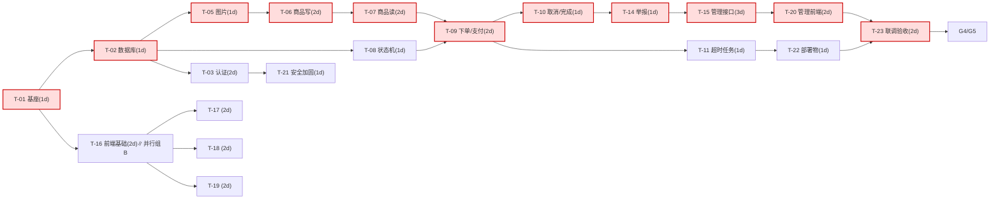

# 7.《任务看板》（活文档）

| 项目 | 内容 |
|---|---|
| 版本 | V1.0 |
| 日期 | 2026-11-11 |
| 依据 | 03§3.8 任务拆分 + 04 追溯矩阵 + 02 设计章节 |
| 维护规则 | 每阶段结束更新"状态"列；任务卡执行须走阶段 3 八步流程（03§3.8 DoD 为准出） |

## 7.1 看板总览（23 卡）

> 状态口径：待开发 / 进行中 / 待评审 / 已完成 / 延期。优先级：P0 关键路径 / P1 / P2。
> 预估工作量单位=人日（[假设]，来源 03§3.8；排期口径见 CH-005：P2 允许延期）。

| 任务ID | 任务名 | 关联FR/NFR/BR | 设计章节 | 前置依赖 | 输入 | 输出 | DoD | 预估 | 优先级 | 风险 | 测试用例来源 | 状态 |
|---|---|---|---|---|---|---|---|---|---|---|---|---|
| T-01 | 工程初始化（git init、backend/frontend 骨架、统一 Result/错误码、CORS、Vite 代理、CI 门禁脚本） | 全局 / NFR-MAINT-03 | 03§3.3、3.5；02§2.3.1 | — | 02§2.3.1 包结构、03§3.4 配置表 | 可构建可启动的两端工程 + scripts/ci.sh | 两端可启动，health 200，ci.sh 全绿 | 1 | P0 | 环境：本机缺 JDK/Maven（阻塞解除方案见 7.4） | G2 门禁清单（mvn verify ✓ / vite build ✓ / health UP ✓） | 已完成 |
| T-02 | 数据库基线：schema.sql + data.sql + 实体/Mapper + SQLite WAL 配置 | BR-02/09/10 字段约束；NFR-PERF-03 索引 | 02§2.4.1~2.4.3 | T-01 | 02§2.4.2 表结构 | 9 张表 + 种子数据 + 实体/Mapper | 首次启动自动建库并有种子数据（分类 4 条/admin/敏感词）。**SQL 基线已用 sqlite3 独立验证通过（2026-11-11：建库/种子 4+20/幂等/CHECK×3/UNIQUE×2/FK×4/tryLock 乐观锁语义 changes=1→0）；实体/Mapper Java 代码待 R-01 解除** | 1 | P0 | SQLite 方言差异 | G2 种子数据加载检查（分类 4 + 敏感词 20 已验证，WAL 生效） | 已完成 |
| T-03 | 认证：注册/登录/JWT/失败锁定/改密全失效 | FR-AUTH-01/02/04、BR-01、NFR-SEC-01/02/05 | 02§2.5.2 API-01/02/06、2.6.2、2.7 | T-02 | API-01/02/06 契约、BR-01 | AuthController/Service + JWT 体系 | 单测覆盖 BR-01 全分支（TC-01 三分支 ✓）+ 集成链路（注册→登录→改密→旧 token 401，TC-17 ✓），41 用例全绿 | 2 | P0 | 无 | TC-01、TC-02、TC-17 | 已完成 |
| T-04 | 用户资料与主页（API-04~07） | FR-AUTH-03、FR-REVIEW-02 | 02§2.5.2 | T-03 | API-04~07 契约 | UserController 资料/主页接口 | 资料修改即时生效（TC-16） | 1 | P1 | 无 | TC-16、TC-30（信用分联调） | 待开发 |
| T-05 | 图片上传/读取（API-08/09） | FR-GOODS-01、BR-10、NFR-SEC-03 | 02§2.5.2、2.7 | T-01 | BR-10 规则 | FileController/Service + 本地存储 | 5MB/JPG-PNG-WEBP 校验与越界拒绝用例通过 | 1 | P0 | 图片路径穿越——已防护（canonical 校验，用例覆盖） | TC-18（上传分支） | 已完成 |
| T-06 | 商品发布/编辑/上下架/删除（API-10~13） | FR-GOODS-01~04、BR-02/09、BR-10 | 02§2.5.2、2.6.5 | T-05 | 状态机迁移表、BR-09/10 | GoodsController/Service | 状态机单测全迁移分支通过 | 2 | P0 | 状态机迁移表遗漏分支——全分支单测覆盖 | TC-08、TC-18、TC-19、TC-20 | 已完成 |
| T-07 | 商品列表/详情/搜索/我的商品（API-14~16） | FR-GOODS-05~08、NFR-PERF-01/02 | 02§2.5.2、2.4.2、2.7 | T-06 | 索引设计、SortType 枚举 | 列表/详情/搜索查询 | 筛选组合与空态用例通过 | 2 | P0 | SQLite LIKE 性能——目标规模（日活 300）远低于阈值，LIKE 条件由集成测试覆盖 | TC-21、TC-22、TC-23、TC-24 | 已完成 |
| T-08 | 状态机工具包（goods/order 迁移表+守卫） | BR-02 | 02§2.6.5 | T-02 | 01§1.5.2/1.5.3 状态机图 | GoodsStateMachine/OrderStateMachine | 覆盖率 ≥ 80%（该包）——迁移全分支已断言覆盖（32 用例），jacoco 统一报告归 T-23 | 1 | P0 | 无 | 迁移表全分支单测（TC-08/19/20 基础） | 已完成 |
| T-09 | 下单互斥 + 模拟支付（API-17/18） | FR-ORDER-01/02、BR-04/05/06/12、NFR-SEC-02 | 02§2.6.1、2.6.2、2.6.6 | T-07、T-08 | 时序图、事务边界 | OrderService 下单/支付 | 并发 10 线程下单仅 1 成功（测试断言） | 2 | P0 | SQLite 写并发——TC-03 并发集成验证：10 线程恰 1 单成功（BR-06 达成），WAL+busy_timeout 兜底 | TC-03、TC-04、TC-06 | 已完成 |
| T-10 | 取消/完成/我的订单（API-19~21） | FR-ORDER-03/05/06 | 02§2.6.6 | T-09 | 事务边界汇总 | 取消/完成/列表 | TC-25/26 端到端 + 10 单测通过（含 unlock 行数一致性兜底） | 1 | P0 | 无 | TC-25、TC-26、TC-27 | 已完成 |
| T-11 | 超时关闭定时任务 | FR-ORDER-04、BR-03 | 02§2.6.3 | T-09 | timeout_at 字段与扫描 SQL | OrderTimeoutScheduler | 时间加速单测：超时订单被关闭并回滚 | 1 | P0 | 定时与人工操作竞态——TC-06 端到端验证（并发双跑恰关一次）；另修复 IMMEDIATE 事务模式根因 | TC-05、TC-06 | 已完成 |
| T-12 | 留言模块（API-22~24） | FR-MSG-01~03、BR-11 | 02§2.5.2、2.3.2 | T-07 | sensitive_word 表 | Message 模块 | 敏感词拦截与回复层级用例通过 | 1 | P1 | 无 | TC-11、TC-28、TC-29 | 已完成 |
| T-13 | 评价模块（API-25/26） | FR-REVIEW-01、BR-07 | 02§2.5.2 | T-10 | UNIQUE 约束设计 | Review 模块 | 双方各一评/越权拒绝用例通过 | 1 | P1 | 无 | TC-12、TC-30 | 已完成 |
| T-14 | 举报模块（API-27/28） | FR-RPRT-01/02 | 02§2.5.2 | T-07 | report 表 | Report 模块 | 重复举报提示用例通过 | 1 | P1 | 无 | TC-31、TC-32 | 已完成 |
| T-15 | 管理后台接口：审核/举报处理/封禁/仲裁/看板（API-29~36） | FR-ADMIN-01~05、BR-08、NFR-SEC-04 | 02§2.6.4、2.6.6、2.7 | T-06、T-10、T-14 | 管理契约+审计 AOP | Admin 模块 8 接口 | 每管理动作落审计日志断言 | 3 | P0（P2 子项可延期） | T-15 体量最大——实际未拆分，一次交付（18 用例：14 单测含审计断言 + 4 集成端到端） | TC-07、TC-10、TC-33、TC-34、TC-35、TC-39 | 已完成 |
| T-16 | 前端：布局/首页/详情/搜索 | FR-GOODS-05/06/07、NFR-COMPAT-01/02 | 01§1.9.1（页面规格） | T-01 | 页面清单/空态规格 | 4 页面 + GoodsCard/StatusTag | 桌面+375px 视口走查通过 | 2 | P0 | 无 | TC-21/22/23 走查、TC-41/42 | 已完成 |
| T-17 | 前端：发布/我的商品/个人资料 | FR-GOODS-01/02/03/04/08、FR-AUTH-03 | 01§1.9.1（页面规格） | T-16 | 上传组件/表单校验 | 3 页面 | 图片上传与表单校验走查通过 | 2 | P1 | 无 | TC-16、TC-18 | 已完成 |
| T-18 | 前端：订单列表/支付页/倒计时 | FR-ORDER-01~06 | 01§1.9.1（页面规格） | T-16 | Q9 默认：订单页一键模拟支付 | 订单页 + OrderCountdown | 待支付倒计时与状态流转走查通过 | 2 | P0 | 无 | TC-03/04/05/06 走查 | 已完成 |
| T-19 | 前端：留言/评价/举报/他人主页 | FR-MSG-01~03、FR-REVIEW-01/02、FR-RPRT-01/02 | 01§1.9.1（页面规格） | T-16 | 空态/异常态规格 | 4 页面 | 全部空态/异常态展示正确 | 2 | P1 | 无 | TC-11/12/28/30/31 走查 | 已完成 |
| T-20 | 前端：管理后台 5 页 | FR-ADMIN-01~05 | 01§1.9.1（页面规格） | T-15 | 管理契约 | 5 页面 | 队列刷新与驳回原因必填生效 | 2 | P1（P2 子项可延期） | 无 | TC-07/10/33 走查 | 已完成 |
| T-21 | 安全加固与日志：@PreAuthorize、AOP 审计、traceId、限流 | NFR-SEC-02/03/04/05、NFR-MAINT-02 | 02§2.7 | T-03 | 错误码表、审计字段 | 安全体系完整 | 越权矩阵测试全 403 | 1 | P0 | 无 | TC-09、TC-38、TC-39、TC-44 | 待开发 |
| T-22 | 部署物：systemd/备份脚本/恢复文档/压测脚本/数据体检脚本 | NFR-AVAIL-01/02、NFR-PERF-01/02/03 | 02§2.2.3、2.7 | T-11 | deploy/ 目录设计 | market.service、backup.sh、restore.md、JMeter 脚本、check-data.js | 恢复演练成功；50 并发压测达标 | 1 | P0 | A-14 部署形态待定 | TC-13、TC-15、TC-36、TC-37、TC-40 | 待开发 |
| T-23 | 端到端联调 + 缺陷修复 + 验收测试执行 | 全部 FR/NFR/BR | 03§3.9、3.13 | T-16~T-22 | 全部用例 | 验收报告 + 缺陷清单 | 03§3.13 清单全绿 | 2 | P0 | 无 | TC-01~TC-45 全量 | 待开发 |

## 7.2 排期建议

| 里程碑 | 内容 | 卡片 | 单人日历 | 双人日历 |
|---|---|---|---|---|
| M1 基座 | T-01、T-02（含 G2 门禁） | 基础 | 第 1~2 日 | 第 1~2 日 |
| M2 交易闭环（P0） | T-08/T-03/T-05→T-06→T-07→T-09→T-10→T-11 + T-21 + T-16/T-18 | 核心 | 第 3~14 日 | 第 3~14 日（第二人并行 T-16~T-19） |
| M3 功能完整（P1） | T-04/T-12/T-13/T-14/T-15/T-17/T-19/T-20 | 完整 | 第 15~24 日 | 第 15~24 日 |
| M4 可上线 | T-22、T-23 + G4/G5 | 发布 | 第 25~26 日 | 第 25~26 日 |

- 总量约 30 人日（A-09）；关键路径 18 人日决定日历下限（见 7.3），双人并行可将非关键路径（前端/管理）错峰吸收，日历约 26 天 ≤ 03§3.12 M1~M4 口径。
- P2 子项（FR-MSG-03、FR-RPRT-02、FR-ADMIN-04/05 对应的 T-12/T-14/T-15/T-20 部分）按 CH-005 默认延期不阻塞 M4，G5 验收前显式确认。

## 7.3 关键路径图

- **关键路径（红）**：T-01→T-02→T-05→T-06→T-07→T-09→T-10→T-14→T-15→T-20→T-23 = **18 人日**。
- 与 03§3.8 注脚"P0 链路 T-01→T-11→T-16→T-18→T-22"口径差异说明：该注脚为 P0 功能链路（非时长最优链）；本图按依赖+工作量计算的最长链为 18 人日，两者不矛盾，以本图作排期依据。

## 7.4 环境风险登记（阶段 2 输入）

| 风险 | 事实 | 处置 |
|---|---|---|
| R-01 本机无 JDK/Maven | **已解除（2026-11-11）**：用户修复宿主机网络后，从清华源安装 Temurin JDK 17.0.21 + Maven 3.9.16 至 ~/.local | 已关闭 |
| R-02 Node/npm 工具链不可用 | **已解除**：Node 20.18.1（npm 10.8.2）安装至 ~/.local/node，registry=npmmirror | 已关闭 |
| R-04 网络不可达 | **已解除**：根因=Agent 会话与用户终端网络命名空间差异；用户修复后 eth0 UP、清华源 200 | 已关闭 |
| R-03 sqlite3 可用 ✅、git 可用 ✅ | 3.51.1 / 2.34.1 | 直接使用 |
| R-05 经验沉淀 | 用户终端与 Agent 沙箱会话网络隔离：宿主机网络修复后沙箱同步恢复；诊断应分层（接口→路由→DNS→TLS） | 记入 06 CH-006 |

> 状态：阻塞已于 2026-11-11 解除（CH-006）；G2 门禁通过（mvn verify ✓ / vite build ✓ / health UP ✓ / 种子 4\|20 ✓ / WAL ✓）；T-01/T-02 已完成。