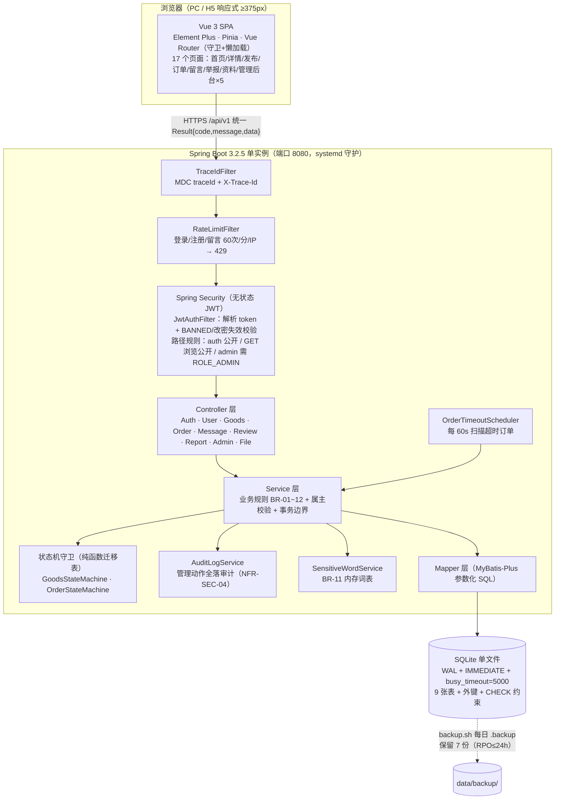
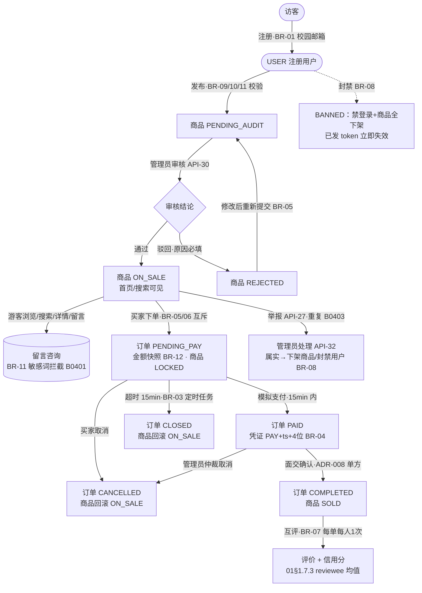
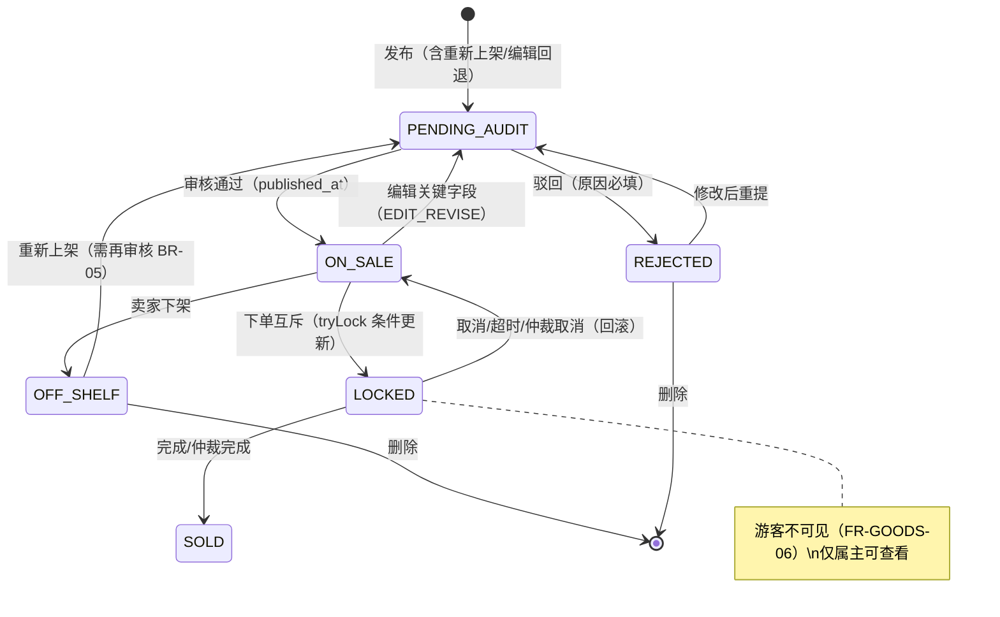
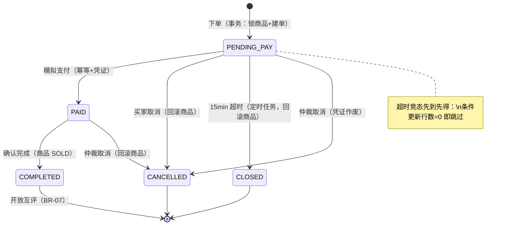
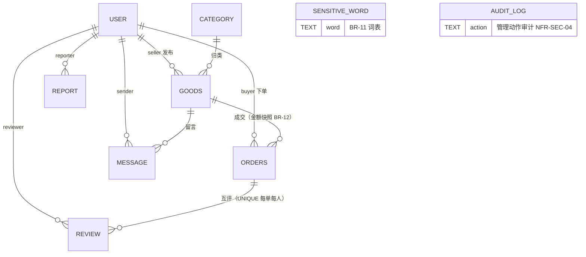
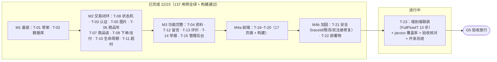

# 系统流程图集（校园二手交易平台 · 拾光集市）

| 项目 | 内容 |
|---|---|
| 版本 | V1.0（对应代码状态：T-01~T-22 已完成，T-23 进行中） |
| 日期 | 2026-11-11 |
| 图源 | 与 doc/01 需求文档、doc/02 设计文档、doc/04 追溯矩阵口径一致 |

---

## 图 1：系统架构与请求处理流（分层视图）

## 图 2：核心业务全链路（主流程 + 治理）

## 图 3：商品状态机（BR-02，迁移表守卫 + 条件更新）

## 图 4：订单状态机（BR-02/03，逐单事务 + 先到先得）

## 图 5：数据实体关系（ER 简版，9 张表）

## 图 6：工程执行流水（T-01~T-23 任务卡状态视图）

---

## 阅读顺序建议

1. **图 1（架构）**：理解请求处理链路与安全层叠（TraceId → 限流 → 鉴权 → 业务）。
2. **图 2（业务全链路）**：理解用户故事与治理闭环。
3. **图 3/4（状态机）**：实现正确性的核心——所有状态迁移由迁移表守卫 + 条件更新双保险（BR-02）。
4. **图 5（ER）**：数据一致性设计的基础（外键 + CHECK）。
5. **图 6（执行流水）**：当前工程进度与门禁状态。